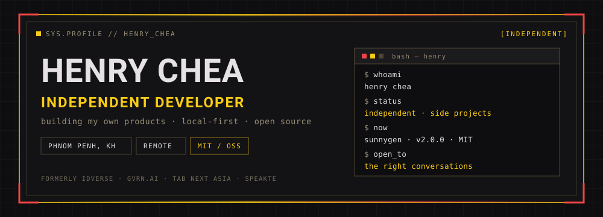
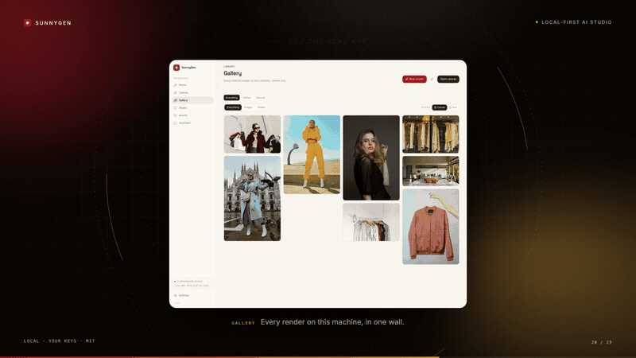
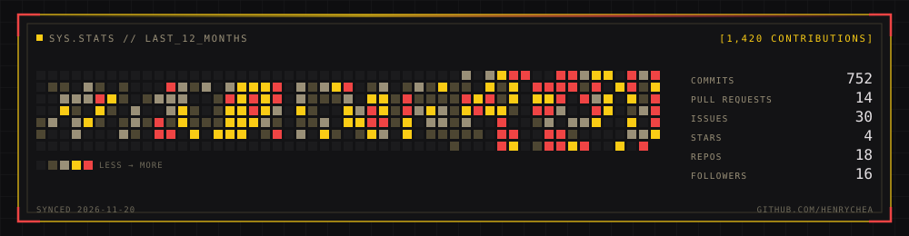
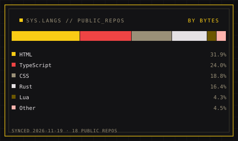
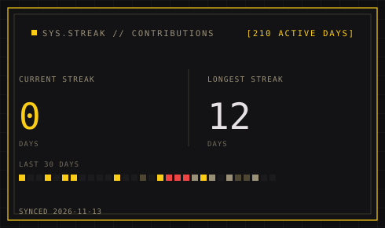

  

  <code>independent developer</code> &nbsp;·&nbsp; <code>side projects</code> &nbsp;·&nbsp; <code>open source</code>

I'm Henry. I build in the open — SunnyGen is the main one; OKPaid and Quick Khmer are still shipping. I like owning a product end to end: API, database, web, mobile, docs. Before that I spent years inside product teams building SDKs, payments, and platforms; that experience is the foundation for the solo work.

## 01 // NOW

### [SunnyGen](https://github.com/henrychea/SunnyGen) — local-first AI studio

  

Your studio. Your machine. Your keys. An MIT-licensed AI studio for image, video, avatars, and outfit work that runs on your own machine instead of someone else's cloud.

- **Local-first:** SQLite, media, and provider keys live in `data/`. No account, no telemetry, no shared credit pool, no markup.
- **Bring your own providers:** Sunra.ai, fal.ai, Azure AI Foundry, a local Codex CLI, and OpenRouter for chat.
- **Real pipelines, not one-off prompts:** Canvas flows you can save and re-run, Gallery wall, Wardrobe, Assistant, and a Studio that renders one to four angles from an avatar.
- **Installable:** PWA shell with offline app cache; reach it over localhost, LAN, or Tailscale.

**Stack:** TanStack Start · TanStack Router · React · TypeScript · SQLite · Tailwind · sharp
**License:** MIT — fork it, wire in a provider, send a PR.

[**Repository**](https://github.com/henrychea/SunnyGen)

### [OKPaid](https://okpaid.io) — merchant POS and business management

Built solo from zero: TypeScript/Hono/Drizzle/Postgres on Neon and Cloudflare, a SolidJS PWA with barcode scanning, an Expo React Native app mirroring the web feature set, and an Astro docs site. RBAC, API keys, migrations, orders, invoices, kiosk POS.

### [Quick Khmer](https://apps.apple.com/kh/app/quick-khmer-keyboard/id6800227587) — Khmer iOS keyboard

Type Latin, get Khmer: phonetic transliteration, automatic consonant stacking, smart suggestions, custom shortcuts, and an on-device dictionary. SwiftUI keyboard extension, shipped to the App Store. No accounts, no ads, no tracking, no network calls.

[**App Store**](https://apps.apple.com/kh/app/quick-khmer-keyboard/id6800227587) · [qkk.henrychea.com](https://qkk.henrychea.com/)

## 02 // BEFORE

The short version of where the experience comes from — years of shipping for other teams, now pointed at my own products.

| Duration | Role | Company | What I built |
|---|---|---|---|
| ~2 yrs | Frontend Engineer | IDVerse, Remote | Multi-language SDKs (Node.js, JavaScript, Rust, Leptos), shared component libraries, SDK tooling used across teams |
| ~3 yrs | Full Stack Developer | GVRN.ai, Remote | NestJS, Redis, BullMQ, AWS, Stripe billing, DocuSign, Sumsub KYC, Ethereum wallet payments and smart contracts |
| ~2 yrs | Team & Tech Lead, Co-Founder | SpeakTe, Phnom Penh | System architecture, Chrome extension, financial planning, investor pitches |
| ~1 yr | Frontend Developer | Tab Next Asia, Remote | Vue.js, .NET Web SDK, mentored two junior frontend developers |

**BSc in Information Communications Technology**, University of Puthisastra, Phnom Penh (2017–2021), GPA 3.6/4.0

## 03 // STACK

**Languages**

**Frontend & Mobile**

**Backend & Infrastructure**

**Integrations & Tools**

## 04 // PROJECTS

| Project | Stack | What it is |
|---|---|---|
| [**SunnyGen**](https://github.com/henrychea/SunnyGen) | TanStack Start, React, SQLite, TypeScript | Local-first AI studio: Canvas pipelines, Gallery, Wardrobe, Studio angles. MIT |
| [**OKPaid**](https://okpaid.io) | Hono, Drizzle, Postgres, SolidJS, Expo, Astro | Merchant POS and business management, built solo end to end |
| [**Quick Khmer**](https://apps.apple.com/kh/app/quick-khmer-keyboard/id6800227587) | SwiftUI, iOS Keyboard Extension | Type Latin, get Khmer. On-device dictionary, no tracking |
| Gling.ai | Electron, Solid.js | Desktop video app: timeline scrubbing, automated subtitles with precise timestamps |
| Lawato | Full-stack SaaS | Legal CRM and practice management: cases, time logging, billing, PDF invoices |
| SpeakTe | EdTech platform | Co-founded; English-speaking skills platform and a Chrome extension for training analytics |

## 05 // STATS

  

  
  

## 06 // CONTACT

- **Email:** [henrychea@outlook.com](mailto:henrychea@outlook.com)
- **LinkedIn:** [linkedin.com/in/cheahenry](https://www.linkedin.com/in/cheahenry)
- **Website:** [henrychea.com](https://www.henrychea.com)
- **GitHub:** [github.com/henrychea](https://github.com/henrychea)

Open to the right conversations — email is the fastest way to reach me. Also glad to talk open source, SunnyGen, or local-first architecture.

  <em>Languages: English (native), Khmer (native)</em>

